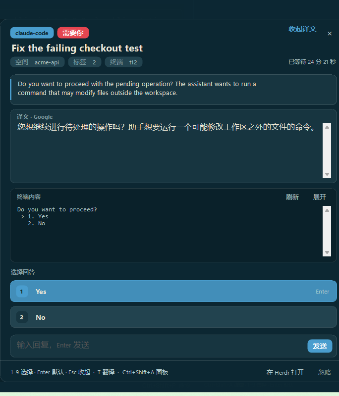

# Approval Relay

Windows 上给 Herdr App 的 agent 审批加一层系统级弹窗：agent 进入 `blocked` 时，右下角出现置顶窗口，显示任务、问题和终端原文；点选项或输入文本后，答案直接送回对应终端。只转发人明确做过的选择，不自动批准。



## What you see

- **无侧边面板**：布局不挂载可见的 approval-relay 面板或浮动把手；只保留 0 宽 `approval-relay-host` 让检测逻辑运行。
- **弹窗**：鼠标所在屏幕右下角，置顶、不占任务栏。颜色取自 Herdr 的 `settings.json` + `themes/<name>.json`（dark/light），圆角卡片、降噪的终端原文（默认 12 行，可展开）、整行选项（数字徽标 + 默认项 `Enter` 提示）、内联回复框。底部固定显示 `1–9 选择 · Enter 默认 · Esc 收起 · <快捷键> 叫出弹窗`，右侧是 `在 Herdr 打开` / `忽略`。
- **托盘**：黄色警告图标表示有待审批，灰蓝应用图标表示空闲；左键叫回弹窗，右键菜单显示数量并可退出助手。不再额外弹系统气泡，避免盖住弹窗本身。
- 语言：`language: "auto"` 先看当前布局是否 `zh*`，否则跟系统 UI 语言；弹窗右上角 `中/EN` 可即时切换。所有固定文案来自 `i18n.json`，agent 的标题/问题/屏幕保持原文。
- 翻译：问题卡右上角「翻译」或按 `T`。先 `clients5.google.com/translate_a/t?client=dict-chrome-ex...`，失败再 `POST edge.microsoft.com/translate/translatetext`（`to=zh-Hans`）；译文卡显示「译文 · Google/Microsoft」，再次点击/`T` 收起。只发问题文本（问题为空时发最后一段屏幕），不上传完整会话。
- 面板开关：已移除；审批只通过独立弹窗出现。
- 设置页：mod 启动时把 `settings-methods.js` 注入 `frame/settings/main.js`，把 `approvals` 追加到 `SECTIONS` 末尾（隐私之后），在渲染链加 `this.approvalPage(t, cx)`。页面有三块：启用、翻译开关、可拖动的服务顺序列表；快捷键不在这里写；侧边面板快捷方式已移除。拖动用 `on_mouse_down` / `on_mouse_move` / `on_mouse_up` 记录 `trDrag` / `trOver`，松开时 splice `translation.order` 并保存。配置写 `data/approval-relay/config.json`，用 `writeTextFile` 的 expected 快照。

## How it behaves

- 只有 Herdr App 窗口开着时才会发现新请求；弹窗助手可以独立存活，已入队的请求在 App 退出后仍能由助手回答（它自己调用 `hc`）。
- `blocked` 只是 agent 上报的“需要人”，可能来自普通输出。mod 会读可见屏幕，只有选项位于底部、下面只剩按键提示/状态栏时才认为是活对话框；识别不出就退回通用按键，不猜。
- 选项解析：`❯ 1. Yes` / `> 1. Yes` / `1) Yes` 这类编号；`[y/N]`、`(y/n)`；Claude 的框线会被剥掉。编号选项发送 `编号 + Enter`，y/n 发送 `y/n + Enter`。
- 通用按键：`Enter`、`Esc`、`↑`、`↓`、`Tab`、`1`、`2`、`3`、`Y`、`N`。数字键可直接选对应编号；`Enter` 选默认项；在自由文本框里 `Enter` 发送文本。
- 发送后等 700ms 查一次 `hc get`：离开 `blocked` 记为完成；仍 `blocked` 记一次重试，达到 `maxAttempts` 后不再自动弹，并提示去终端看。
- 正在看的 agent（`focused` 且 Herdr 窗口在前台）默认不弹；可在配置里关掉 `skipFocused`。
- 用户在终端里自己回答了，mod 下一次轮询发现状态离开 `blocked`，会删除队列请求并记 `external`。

## Built from

```
mods/approval-relay/
  main.js                 View；轮询 agents()、hc read、parse、排队、审计（面板不挂载）
  parse.js                cleanScreen / screenHash / parseApproval
  i18n.js / i18n.json     语言解析、快捷键格式化、中英文案
  settings-methods.js     注入到设置页的「审批」页方法
  helper/approval-popup.ps1  主题化 WinForms 窗口 + NotifyIcon；调用 hc 回答；翻译走 Google/Microsoft
  mod.json                { "place": "right", "size": 320 }
```

- `main.js`：`init` 建 `data/approval-relay/{queue,answers}`，`cx.timer.every(1500)` 调 `tick`；`agents()` 里 `status === "blocked"` 的进入 `inspect`；`hc(["read", address, "--lines", "0", "--json"])` 读屏；`parseApproval` 成功后写 `queue/<id>.json`；`collectAnswers` 读 `answers/*.json` 写 `audit.jsonl`；`ensureHelper` 用 `exec("powershell.exe", ["-NoProfile","-WindowStyle","Hidden","-Command", "Start-Process ..."])` 拉起助手（`exec` 只负责启动，不等弹窗）。
- `parse.js`：去 ANSI/OSC；找最靠底部、连续编号的选项段；`tailIsQuiet` 要求选项下只剩提示/状态栏；`questionBefore` 收集问题；`screenHash` 对最后 50 行做 FNV-1a，用于去重。
- `i18n.js`：`resolveLanguage(config, locale, layout)`（强制 > `zh*` 布局 > 系统语言）、`makeT` 缺 key 回退 en、`formatShortcut` / `findShortcut` 从 `keys.json` 找 `approval-relay.open`。
- helper 视觉：`Add-Type` 里用 C# 画 `Card` / `RowButton` / `KeyCap` / `Chip` / `TextButton`，全部圆角；颜色解析 `#RRGGBB(AA)`；`S()` 按 `DeviceDpi / 96` 缩放像素，字体按 point 缩放；标题栏 `WM_NCLBUTTONDOWN` 拖动。
- helper：单实例互斥量；700ms 扫 `queue`；`Write-JsonAtomic` 写 `answers`（UTF-8 无 BOM）；`hc keys <addr> ...` 或 `hc send --force <addr> <text>`；`hc get --json` 校验 `status.state`；托盘 `ShowBalloonTip`；窗口位置取鼠标所在屏幕的 `WorkingArea`。
- 配置：`data/approval-relay/config.json`（`enabled`、`skipFocused`、`language`、`translation.enabled`、`translation.order`、`readCooldownMs`、`maxAttempts`）；设置页和 mod/helper 共用这个文件，mod 每 3 秒重读，helper 每次翻译重读；审计：`data/approval-relay/audit.jsonl`；助手日志：`helper.log`；`lang` 文件让助手启动时就用对语言。
- 快捷键：不再注册侧边面板快捷键；`approval-relay.lang` 仍由 `nextCommand()` 处理。
- 翻译：`Translate-Google` / `Translate-Microsoft` 都在 helper 里同步调用（7s 超时）；按 `translation.order` 依次尝试，失败换下一个；结果按当前请求缓存，切换请求就清空。

## Watch out

- 只支持 Windows；helper 是 Windows PowerShell 5.1 + WinForms，不是通知中心卡片。macOS/Linux 要换 helper。
- 必须能从 PATH 或默认位置找到 `hc.exe` 和 `herdr-app.exe`；找不到时托盘会提示，按钮不会执行。
- `hc send` 在 `blocked` 时默认拒绝，所以自由文本必须 `--force`；只在用户点「发送文本」时用。不要把它接到自动规则上。
- 解析器宁可漏：普通输出里打印的 `Do you want to proceed?` 后面如果有正文，不会触发；未知 TUI 只给通用按键。
- 不要给 approval-relay 挂可见的布局节点；需要检测逻辑时用 0 宽 host。
- `Start-Process` 启动的 helper 没有主窗口标题，按 PID（`helper.json`）激活最可靠。
- 多显示器时弹窗出现在鼠标所在屏幕；预览截图要注意别截错屏。
- 单实例互斥量是 `HerdrApprovalRelayHelper`，跨 HERDR_APP_HOME 共享；helper 支持 `-MutexName`，预览/测试用独立名字即可，不要先停生产 helper。
- C# `Add-Type` 需要 `-ReferencedAssemblies System.Drawing, System.Windows.Forms`；类里引用静态 `Paint` 要写全 `HerdrApproval.Paint`（`Control.Paint` 会遮蔽同名）。
- 自定义控件必须开 `SupportsTransparentBackColor` 且 `BackColor=Transparent`，否则圆角外会露出灰底。
- 文案缺 key 时回退英文；新增语言只需在 `i18n.json` 加一张表，注意 UTF-8 无 BOM。
- 翻译端点是非公开接口，429/404/改路径都可能发生；必须保留回退和失败提示，不要把它当成 SLA API。
- 安装脚本会改 `layouts/*.json`：删掉旧的审批面板/把手，补一个 0 宽 host；每个文件先备份 `.bak`，并 `layout.switch` 重新加载。
- 不能用删除 host 节点的方式关闭检测；否则 mod 不再实例化，弹窗也不会出现。
- 设置页是运行时注入：Herdr 启动会还原 `frame/settings/main.js`，mod 再注入。写入时与 zh-cn 的 shortcuts mod 共用 `.shortcuts-lock`，避免两个写入者互相覆盖；锚点用 `const SECTIONS = [`、`: this.section === "keyboard"`、`  render(cx) {`，升级后锚点没了要重新适配。

## Done when

- `node --test test/*.mjs`：编号框、框线、y/n、打印过的旧提示、底部之外菜单、通用按键、ANSI、hash；语言优先级、快捷键格式化、缺 key 回退全部通过。
- 翻译：造一个英文审批请求，按 `T` 后译文卡出现且来源为 Google；屏蔽 Google 时回退 Microsoft。
- 设置 → 审批：开关启用/翻译，按住 `⠿` 拖动服务顺序（单击不生效）；`config.json` 立即更新，mod 在 3 秒内重读，helper 下次翻译用新顺序。
- 弹窗按 `T`：helper 先翻译 `question`，再逐个翻译 `options[].label`；翻译结果只改显示，`Tag.keys` 保留原编号，选项行主行中文、副行英文原文。
- 问答型审批：`parse.js` 在找不到编号选项时，用 `kind: "text"` 返回问题和空选项；helper 隐藏通用按键、聚焦输入框，发送走 `hc send --force`。
- 多审批：mod 每个 agent 一个 queue 文件；helper 一次只 `Show-Request` 一个，按队列文件时间排序，标题旁显示剩余数量，当前文件消失后 tick 自动切下一个。
- 兼容格式：编号（`1.` / `1)` / Pi 的 `1  yes`）、无编号高亮列表（oh-my-pi Approve/Approve session/Deny）、opencode Allow once/Always allow/Reject、Pi 二级深度列表；无编号项用 `up`/`down`+`enter` 相对当前高亮计算，`[a]llow` 这类热键直接用字母。
- helper 常驻：mod 只在 `pending.size > 0` 或启动时队列非空才 `ensureHelper`；helper 无 active、无队列超过 `helperIdleSeconds`（默认 120）后自行退出。把 Microsoft 拖到第一后按 `T`，日志应显示 `provider=Microsoft`。
- 设置 → 快捷键：不再有审批侧边面板条目。
- `herdr-app check mods/approval-relay` 输出 `check passed`。
- 造一个假 agent：`printf` OSC 7501 `state=blocked`，屏幕打印 `Do you want to proceed? / > 1. Yes / 2. No`，然后 `ReadKey`；把它放进一个 Herdr 空间并切走。几秒内右侧出现请求、弹窗出现、托盘变黄。
- 对弹窗按 `1`：假 agent 状态从 `blocked` 变 `idle`，`queue`/`answers` 清空，`audit.jsonl` 出现 `answered`，弹窗关闭。
- 关掉弹窗不点击：状态保持 `blocked`，请求仍在队列。
